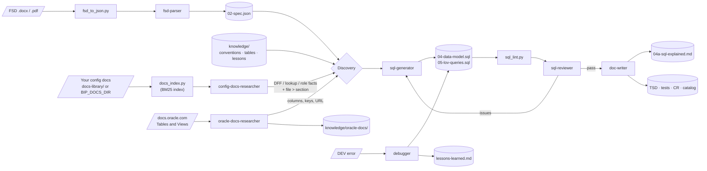

# BIP Report Builder Agent

**A Claude Code agent that turns an Oracle Fusion Functional Spec (FSD) into a complete set of BI Publisher report deliverables:** a structured spec, parameterized data-model SQL, a plain-English **explanation of that SQL** (which tables, why, and from which source), LOV queries, RTF layout guidance, a Technical Spec (TSD), a unit-test plan with validation queries, IT change-request text and a metadata-catalog entry.

It is built for Business Analysts and report developers on Oracle Cloud ERP/HCM programs (PPM, HCM, AP/AR, GL). The agent handles roughly the first 80% of the work: reading the FSD, finding and verifying the tables, writing the SQL and the paperwork. You keep the last 20%: running it in DEV, confirming the data and signing off.

> No extra services. Everything runs in [Claude Code](https://claude.com/claude-code) with a local Markdown knowledge base, Oracle's public documentation and a few small Python helpers.

---

## Why

Building a BIP report by hand usually looks like this: read a 15-page FSD, hunt for the right `PJF_`/`PER_`/`AP_` tables, dig through configuration workbooks to find which `ATTRIBUTEn` holds a DFF, write the SQL, debug `ORA-` errors in DEV, then write the TSD, test plan, change request and catalog entry. This agent does that with **sources for every fact**:

- **Oracle Docs as the source of truth.** Every table and column is checked against Oracle's *Tables and Views for Oracle Fusion Cloud* on docs.oracle.com, then cached in `knowledge/oracle-docs/` with the URL and release.
- **Your configuration docs as a searchable library (local RAG).** Drop your DFF/value-set/lookup/setup documents (docx, pdf, xlsx, csv, md) into `docs-library/`, or point it at a shared folder. The agent searches them for environment-specific facts such as *"Billing Code = ATTRIBUTE1, global segment"* and cites `file > section`.
- **SQL you can understand.** Each report gets `04a-sql-explained.md`: a lineage diagram, a CTE-by-CTE walkthrough, column-to-table lineage and what can make a value blank.
- **Same conventions every time:** multi-select null checks, `TO_CHAR` on IDs, `TRUNC` on dates, `_TL` language filters, `ROW_NUMBER()` de-duplication. A linter enforces them.
- **No invented tables or columns.** Anything unconfirmed is marked VERIFY and comes with a discovery query to run in DEV.
- **It learns from your errors.** Paste an `ORA-` error back in. It diagnoses it, fixes the SQL and adds the lesson to `knowledge/lessons-learned.md`.

## Sources of truth

| Rank | Source | Answers | Tool |
|---|---|---|---|
| 1 | **You**, from DEV | anything (discovery-query results, fixes) | chat |
| 2 | **Your configuration docs** | *What does it mean here?* DFF context/segment → `ATTRIBUTEn`, value sets, lookups, custom roles/statuses, CoA segments | `config-docs-researcher` + `scripts/docs_index.py` |
| 3 | **Oracle Docs** (docs.oracle.com) | *Does it exist, and what is it called?* Tables, views, columns, keys, view base tables, per release | `oracle-docs-researcher` (WebSearch/WebFetch) |
| 4 | **Knowledge base** | *How do we usually do it?* Join patterns, gotchas, lessons learned | `knowledge/` |

Oracle Docs tells you `PJF_TASKS_V` has `ATTRIBUTE1`–`ATTRIBUTE15`; only your configuration tells you which one is the Billing Code. Both are cited.

## Quickstart

```bash
# 1. Clone and install the Python helpers
git clone https://github.com/<you>/bip-report-builder-agent.git
cd bip-report-builder-agent
pip install -r requirements.txt          # python-docx, pdfplumber, openpyxl, jsonschema

# 2. Environment-specific IDs (kept out of git)
cp templates/environment.example.md private/environment.md

# 3. Your configuration docs: copy into docs-library/ (gitignored) ... or point at a shared folder
export BIP_DOCS_DIR="/path/to/synced/ERP Config Docs"   # optional

# 4. FSD into inputs/ (gitignored), then start Claude Code
claude
```

Inside Claude Code:

```
/ingest-docs                                 # index your configuration docs (once, and when they change)
/build-report inputs/My_Report_FSD.docx      # full pipeline
```

Everything lands in `output/<REPORT_ID>/` (gitignored):

| File | What it is |
|---|---|
| `00-review.md` | **Read this first.** Open questions, assumptions, sources used, self-review |
| `01-fsd-raw.json` | Text and tables extracted from the FSD |
| `02-spec.json` | Structured spec validated against `templates/fsd-spec.schema.json` |
| `03-discovery.md` | Field → table.column with a **Source** for each (Oracle Docs URL / config doc / KB) and discovery queries for VERIFY items |
| `04-data-model.sql` | BIP data-set SQL (one CTE per concept; each CTE cites its sources) |
| `04a-sql-explained.md` | **Plain-English walkthrough:** lineage diagram, step by step, column lineage, parameters, blank-value causes |
| `05-lov-queries.sql` | One LOV query per parameter |
| `06-data-model-params.md` | BIP parameter + LOV definitions |
| `07-rtf-layout.md` | RTF template guidance |
| `08-tsd.md` | Technical Specification |
| `09-test-plan.md` + `09-validation.sql` | Unit tests + row-count, duplicate, null and spot-check queries |
| `10-it-change-request.md` | IT CR text |
| `11-catalog-entry.md` | Alation / metadata catalog entry |

### Slash commands

| Command | Purpose |
|---|---|
| `/build-report <fsd-path> [reuse: <sql-file or report-id>]` | Full pipeline, FSD → all deliverables |
| `/ingest-docs [folder]` | Index your configuration docs; summarize the DFF → `ATTRIBUTEn` mappings found |
| `/ask-docs <question>` | Cited answer from your configuration docs ("which column holds the billing code?") |
| `/lookup-table <OBJECT> [columns]` | Check a table/view on Oracle Docs and cache the result |
| `/explain-sql <sql-file or report-id>` | Plain-English walkthrough + lineage for **any** SQL, including existing reports |
| `/review-sql <sql-file> [spec.json]` | Convention + coverage + sources review |
| `/debug-error <report-id> <error text / wrong output>` | Diagnose, fix the SQL and record a lesson |
| `/write-tsd <report-id>` · `/catalog-entry <report-id>` | Regenerate one document |

## Architecture



| Piece | Location | Role |
|---|---|---|
| Orchestrator | `CLAUDE.md` + `.claude/commands/` | Pipeline, source precedence, slash commands |
| Sub-agents | `.claude/agents/` | `fsd-parser`, `oracle-docs-researcher`, `config-docs-researcher`, `sql-generator`, `sql-reviewer`, `doc-writer`, `debugger` |
| Knowledge base | `knowledge/` | Conventions (C-01…C-14), table notes, **Oracle Docs cache**, lessons learned, report catalog |
| Config-docs library | `docs-library/` (gitignored except `samples/`) | Your DFF / value set / lookup / setup documents |
| Templates | `templates/` | Spec schema, TSD, SQL-explained, test plan, IT CR, catalog entry, environment config |
| Helpers | `scripts/` | `fsd_to_json.py`, `validate_spec.py`, `sql_lint.py`, `docs_index.py` |
| Private config | `private/` (gitignored) | Role IDs and other environment values |

## Example

[`examples/sample-ppm-task-listing/`](examples/sample-ppm-task-listing/) is a fully sanitized walkthrough of a fictional *Project Task Listing* report (PPM):
- All 8 tables were checked against Oracle Docs.
- The Billing Code DFF was resolved from the sample config doc in [`docs-library/samples/`](docs-library/samples/).
- Only 2 items remain VERIFY.

Start with [`00-review.md`](examples/sample-ppm-task-listing/00-review.md), then read [`04a-sql-explained.md`](examples/sample-ppm-task-listing/04a-sql-explained.md).

A taste of the generated SQL:

```sql
-- CTE: tasks - tasks of the driving projects with the billing-code DFF (BR-4)
-- Sources: PJF_TASKS_V incl. CHARGEABLE_FLAG, ATTRIBUTE1..15 [ORACLE_DOCS 26A];
--          Billing Code = ATTRIBUTE1, Global Data Elements (no context filter needed)
--          [CONFIG_DOC sample-ppm-dff-configuration.md > 1. Project Task Descriptive Flexfield]
tasks AS (
    SELECT tsk.project_id, tsk.task_id, tsk.task_number, tsk.task_name,
           tsk.attribute1          AS billing_code,      -- {{TASK_DFF_BILLING_CODE}} = ATTRIBUTE1 (global)
           tsk.chargeable_flag
    FROM   pjf_tasks_v tsk
    WHERE  tsk.project_id IN (SELECT p.project_id FROM projects p)
    AND   (NVL(:p_chargeable_only, 'N') = 'N' OR tsk.chargeable_flag = 'Y')
)
...
-- multi-select null check (C-02) and TO_CHAR on a numeric ID (C-03)
WHERE (COALESCE(:p_project_manager, NULL) IS NULL OR TO_CHAR(pm.pm_person_id) IN (:p_project_manager))
```

## Python helpers

```bash
python scripts/fsd_to_json.py inputs/My_FSD.docx -o output/RPT-X/01-fsd-raw.json
python scripts/validate_spec.py output/RPT-X/02-spec.json
python scripts/sql_lint.py output/RPT-X/04-data-model.sql --spec output/RPT-X/02-spec.json
python scripts/docs_index.py ingest                       # index docs-library/ (or --dir / $BIP_DOCS_DIR)
python scripts/docs_index.py search "task billing code flexfield" -k 5
python scripts/docs_index.py dff --filter task            # every ATTRIBUTEn mapping found in your docs
pip install -r requirements-dev.txt && python -m pytest -q   # run the tests
```

`sql_lint.py` checks these rules:

| Rule | What it checks |
|---|---|
| BIP001 | Multi-select `IN (:p)` without a `COALESCE(:p, NULL) IS NULL` guard |
| BIP002 | `*_ID` column compared to a string parameter without `TO_CHAR()` |
| BIP003 | Date bind used without `TRUNC()` |
| BIP004 | `*_TL` table joined without `LANGUAGE = USERENV('LANG')` |
| BIP005 | Forbidden objects (e.g. `PJF_PROJECT_CUSTOMERS`) |
| BIP006 | `SELECT *` in a data model |
| BIP007 | Unresolved `{{ENV_PLACEHOLDER}}` |
| BIP008 | Spec parameter not used in the SQL |
| BIP009 | Bind variable not declared in the spec |
| BIP010 | Hard-coded 15-digit Fusion ID without an explanatory comment |
| BIP011 | Spec column alias missing from the SQL (FSD coverage) |

## Open-source safety

- **Gitignored:** your configuration docs (`docs-library/`, except `samples/`), FSDs (`inputs/`), generated output (`output/`) and environment values (`private/`). The index for an external `BIP_DOCS_DIR` is written inside that folder, not into this repo.
- **Oracle Docs cache stores facts only:** object and column names, keys, URLs and releases. No copied documentation text.
- **Fictional examples:** everything in `examples/` and `docs-library/samples/` is fictional.

## Roadmap: Oracle AI Agent Studio

The knowledge base and config-docs library are plain files, so they are portable. To run the same assistant inside Fusion with **Oracle AI Agent Studio**:
1. Load `knowledge/` and your configuration documents as the agent's document/knowledge sources (RAG).
2. Reuse the sub-agent prompts in `.claude/agents/*.md` as the Agent Studio agent/topic instructions.
3. Use `templates/fsd-spec.schema.json` as the structured-output contract between the parse and SQL steps.

Claude Code remains the reference runtime.

## Contributing

See [CONTRIBUTING.md](CONTRIBUTING.md). Oracle Docs cache entries, table notes, lint rules and sanitized lessons learned are especially welcome.

## License

[MIT](LICENSE)
