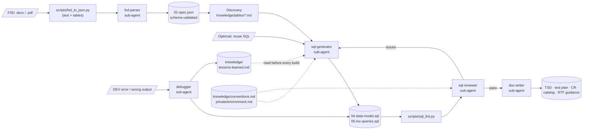

# BIP Report Builder Agent

**A Claude Code agent that turns an Oracle Fusion Functional Spec (FSD) into a complete set of BI Publisher report deliverables:** a structured spec, parameterized data-model SQL, LOV queries, RTF layout guidance, a Technical Spec (TSD), a unit-test plan with validation queries, IT change-request text and a metadata-catalog entry.

It is built for Business Analysts and report developers on Oracle Cloud ERP/HCM programs (PPM, HCM, AP/AR, GL). The agent handles roughly the first 80% of the work: reading the FSD, finding the tables, writing the SQL and the paperwork. You keep the last 20%: running it in DEV, confirming the data and signing off.

> No extra services. Everything runs in [Claude Code](https://claude.com/claude-code) with a local Markdown knowledge base and two small Python helpers.

---

## Why

Building a BIP report by hand usually looks like this: read a 15-page FSD, hunt for the right `PJF_`/`PER_`/`AP_` tables, write the SQL, add parameters and LOVs, debug `ORA-` errors in DEV, then write the TSD, test plan, change request and catalog entry. Most of that follows patterns. This agent applies those patterns consistently:

- **Same SQL conventions every time.** It applies them to every report: multi-select null checks, `TRUNC` on dates, `_TL` language filters and `ROW_NUMBER()` de-duplication.
- **It doesn't invent tables or columns.** When it isn't confident, it gives you the candidates and a discovery query to run in DEV.
- **It learns from your errors.** Paste an `ORA-` error or wrong output back in. It diagnoses it, fixes the SQL and adds the lesson to `knowledge/lessons-learned.md`.

## Quickstart

```bash
# 1. Clone and install the two optional Python helpers
git clone https://github.com/<you>/bip-report-builder-agent.git
cd bip-report-builder-agent
pip install -r requirements.txt          # python-docx, pdfplumber

# 2. Add your environment-specific IDs (kept out of git)
cp templates/environment.example.md private/environment.md
#    ...then edit private/environment.md with your role IDs and DFF mappings

# 3. Drop your FSD in inputs/ (gitignored) and start Claude Code
claude
```

Then, inside Claude Code:

```
/build-report inputs/My_Report_FSD.docx
```

Everything lands in `output/<REPORT_ID>/` (gitignored):

| File | What it is |
|---|---|
| `00-review.md` | **Read this first.** Assumptions, open questions, self-review results |
| `01-fsd-raw.json` | Text and tables extracted from the FSD (`scripts/fsd_to_json.py`) |
| `02-spec.json` | Structured spec validated against `templates/fsd-spec.schema.json` |
| `03-discovery.md` | Field → table/column mapping with confidence levels and discovery queries |
| `04-data-model.sql` | Main BIP data-set SQL (CTE-per-concept, commented, bind variables) |
| `05-lov-queries.sql` | One LOV query per parameter |
| `06-data-model-params.md` | BIP parameter + LOV definitions to enter in the Data Model editor |
| `07-rtf-layout.md` | RTF template guidance: column order, headers, grouping, formats |
| `08-tsd.md` | Technical Specification |
| `09-test-plan.md` + `09-validation.sql` | Unit-test checklist + row-count, duplicate, null and spot-check queries |
| `10-it-change-request.md` | IT CR text |
| `11-catalog-entry.md` | Alation / metadata catalog entry |

When a DEV run fails or returns the wrong data:

```
/debug-error RPT-PPM-001  ORA-00942: table or view does not exist ... (paste the full error)
```

### Slash commands

| Command | Purpose |
|---|---|
| `/build-report <fsd-path> [reuse: <sql-file or report-id>]` | Full pipeline, FSD → all deliverables |
| `/review-sql <sql-file> [spec.json]` | Convention + coverage review (runs `sql_lint.py`, then a reasoning review) |
| `/debug-error <report-id> <error text / wrong output>` | Diagnose, fix the SQL and record a lesson |
| `/write-tsd <report-id>` | (Re)generate the TSD from the spec + SQL |
| `/catalog-entry <report-id>` | (Re)generate the Alation/metadata entry |

## Architecture



| Piece | Location | Role |
|---|---|---|
| Orchestrator | `CLAUDE.md` + `.claude/commands/` | Pipeline order, rules and slash commands |
| Sub-agents | `.claude/agents/` | `fsd-parser`, `sql-generator`, `sql-reviewer`, `doc-writer`, `debugger` |
| Knowledge base | `knowledge/` | Conventions, table notes per module, lessons learned, past-report catalog |
| Templates | `templates/` | Spec JSON Schema, TSD, test plan, IT CR, catalog entry, environment config |
| Helpers | `scripts/` | `fsd_to_json.py` (docx/pdf/md → JSON), `validate_spec.py` (schema + cross-checks), `sql_lint.py` (convention checks) |
| Private config | `private/` (gitignored) | Your role IDs, DFF segment mappings, anything environment-specific |

## Example

[`examples/sample-ppm-task-listing/`](examples/sample-ppm-task-listing/) is a fully sanitized walkthrough of a fictional *Project Task Listing* report (PPM). It goes from FSD to spec JSON, discovery, SQL, LOVs, TSD, test plan, CR and catalog entry. Start with its [`00-review.md`](examples/sample-ppm-task-listing/00-review.md).

A taste of the generated SQL:

```sql
-- CTE: project_client - client contact from the project-parties chain (BR-3)
--      PJF_PROJECT_CUSTOMERS deliberately NOT used (ORA-00942, L-001).
--      dedupe key : project_id   tie-break : latest start_date_active, project_party_id
project_client AS (
    SELECT pp.project_id,
           hp.party_name AS client_name,
           ROW_NUMBER() OVER (PARTITION BY pp.project_id
                              ORDER BY pp.start_date_active DESC,
                                       pp.project_party_id  DESC) AS rn
    FROM   pjf_project_parties pp
    JOIN   hz_parties          hp ON hp.party_id = pp.resource_source_id
    WHERE  pp.project_role_id = {{CLIENT_CONTACT_ROLE_ID}}        -- environment-specific
    AND    TRUNC(SYSDATE) BETWEEN TRUNC(pp.start_date_active)
                              AND NVL(TRUNC(pp.end_date_active), TRUNC(SYSDATE))
),
...
-- multi-select null check (C-02) and TO_CHAR on a numeric ID (C-03)
WHERE (COALESCE(:p_project_manager, NULL) IS NULL OR TO_CHAR(pm.pm_person_id) IN (:p_project_manager))
```

## Python helpers

```bash
python scripts/fsd_to_json.py inputs/My_FSD.docx -o output/RPT-X/01-fsd-raw.json
python scripts/validate_spec.py output/RPT-X/02-spec.json
python scripts/sql_lint.py output/RPT-X/04-data-model.sql --spec output/RPT-X/02-spec.json
pip install -r requirements-dev.txt && python -m pytest -q   # run the tests
```

`sql_lint.py` checks these rules:

| Rule | What it checks |
|---|---|
| BIP001 | Multi-select `IN (:p)` without a `COALESCE(:p, NULL) IS NULL` guard |
| BIP002 | `*_ID` column compared to a string parameter without `TO_CHAR()` |
| BIP003 | Date bind used without `TRUNC()` |
| BIP004 | `*_TL` table joined without `LANGUAGE = USERENV('LANG')` |
| BIP005 | Forbidden objects (e.g. `PJF_PROJECT_CUSTOMERS`) |
| BIP006 | `SELECT *` in a data model |
| BIP007 | Unresolved `{{ENV_PLACEHOLDER}}` |
| BIP008 | Spec parameter not used in the SQL |
| BIP009 | Bind variable not declared in the spec |
| BIP010 | Hard-coded 15-digit Fusion ID without an explanatory comment |
| BIP011 | Spec column alias missing from the SQL (FSD coverage) |

Run `python scripts/sql_lint.py --list-rules` for the full list.

## Open-source safety

- **Keep real FSDs and output out of git.** Real FSDs go in `inputs/` and generated output in `output/`. Both are gitignored.
- **Keep environment-specific values private.** Role IDs, DFF segment mappings, custom role names and lookup IDs go in `private/environment.md` (gitignored). Generated SQL uses `{{PLACEHOLDER}}` tokens until the agent fills them in from that file, and `sql_lint.py` flags any that are left.
- **Use fictional data only.** Everything in `examples/` is fictional and sanitized.

## Roadmap: Oracle AI Agent Studio

The knowledge base is plain Markdown and JSON, so it is portable. To run the same assistant inside Fusion with **Oracle AI Agent Studio**, you could:

1. Load `knowledge/conventions.md`, `knowledge/tables/*.md` and `knowledge/lessons-learned.md` as the agent's document/knowledge sources.
2. Reuse the sub-agent prompts in `.claude/agents/*.md` as the topic/instruction text for the Agent Studio agent(s).
3. Use `templates/fsd-spec.schema.json` as the structured-output contract between the parser step and the SQL step.

Claude Code remains the reference runtime. Nothing here depends on Agent Studio.

## Contributing

See [CONTRIBUTING.md](CONTRIBUTING.md). Table notes, lint rules and sanitized lessons learned are especially welcome.

## License

[MIT](LICENSE)
