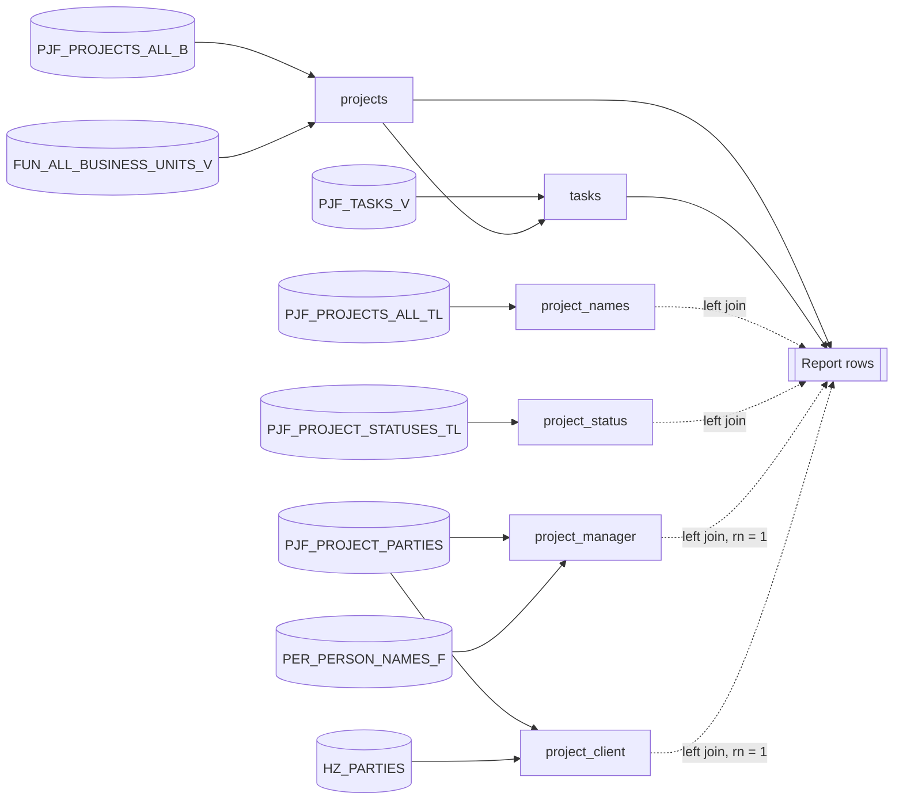

# SQL Explained: RPT-PPM-001 Project Task Listing

> A plain-English walkthrough of [`04-data-model.sql`](04-data-model.sql) v0.2: what each part does, which Fusion tables it reads, how they join, and **where each fact came from**.
> Source tags: **[ORACLE_DOCS]** docs.oracle.com · **[CONFIG_DOC]** configuration docs · **[KB]** knowledge base · **[VERIFY]** not yet confirmed

## 1. In one paragraph
The query returns **one row per project task** for every non-template project that passes the filters (business unit, project number, status, start-date range, project manager, chargeable-only). Each row carries the project's details, its **current** project manager and client contact (one each, picked by the most recent assignment), and the task's **Billing Code**, which is a task descriptive flexfield stored in `ATTRIBUTE1`. Projects without tasks don't appear (A-1). Client Name is blank when no client contact is assigned on the project's Parties tab (BR-3).

## 2. Data lineage

## 3. Step by step

### 3.1 `projects`: which projects are in scope
- **Returns:** one row per project.
- **Reads:** `PJF_PROJECTS_ALL_B` ([ORACLE_DOCS 25D](https://docs.oracle.com/en/cloud/saas/project-management/25d/oedpp/pjfprojectsallb-17373.html)) holds the project itself: number (`SEGMENT1`), status code, start date, BU (`ORG_ID`). `FUN_ALL_BUSINESS_UNITS_V` ([ORACLE_DOCS 25D](https://docs.oracle.com/en/cloud/saas/financials/25d/oedmf/funallbusinessunitsv-5127.html)) turns `ORG_ID` into the BU name.
- **Joins:** `bu.bu_id = prj.org_id`. Each project has exactly one BU, so this is 1:1.
- **Filters:**
  - `template_flag = 'N'` removes project templates (BR-1).
  - BU, project number and status use the multi-select null-safe pattern `COALESCE(:p, NULL) IS NULL OR col IN (:p)` (C-02): leave the parameter blank to get everything.
  - Start-date range: both sides are `TRUNC`ed so a project starting at any time on the "To" date is included (C-04).
- **Why first:** every other step only looks at these projects, so filtering here keeps the query fast (C-12).

### 3.2 `project_names`: the project name in the user's language
- **Reads:** `PJF_PROJECTS_ALL_TL` ([ORACLE_DOCS 25D](https://docs.oracle.com/en/cloud/saas/project-management/25d/oedpp/pjfprojectsalltl-20636.html)). Names are translatable, so they live in the `_TL` table with one row per language.
- **Filter:** `language = USERENV('LANG')` returns exactly one name per project, in the language of whoever runs the report (C-05).

### 3.3 `project_status`: the status name
- **Reads:** `PJF_PROJECT_STATUSES_TL` ([ORACLE_DOCS 25A](https://docs.oracle.com/en/cloud/saas/project-management/25a/oedpp/pjfprojectstatusestl-10733.html)), keyed by status code + language.
- **[VERIFY]:** the display column is assumed to be `PROJECT_STATUS_NAME`; Oracle Docs confirmed only the key columns. Run D-2.
- The parameter filters on the status **code** (in `projects`); this CTE only supplies the label (A-4).

### 3.4 `project_manager`: the current project manager (BR-2)
- **Reads:** `PJF_PROJECT_PARTIES` ([ORACLE_DOCS 25C](https://docs.oracle.com/en/cloud/saas/project-management/25c/oedpp/pjfprojectparties-25874.html)) holds everyone assigned to a project in a role, with start and end dates. `PER_PERSON_NAMES_F` ([ORACLE_DOCS](https://docs.oracle.com/en/cloud/saas/human-resources/oedmh/perpersonnamesf-32501.html)) supplies the person's name.
- **Joins:** `ppnf.person_id = pp.resource_source_id`. For internal people, the party's resource is the HCM person.
- **Filters:**
  - role = Project Manager (`{{PROJECT_MANAGER_ROLE_ID}}`; the ID is instance-specific, D-1);
  - assignment active today;
  - name record active today, with `name_type = 'GLOBAL'`. Without it each person appears once per name format (KB L-003).
- **De-duplication:** a project can have several active PM rows (overlaps, hand-overs). `ROW_NUMBER() OVER (PARTITION BY project_id ORDER BY start_date_active DESC, project_party_id DESC)` keeps the most recent; `project_party_id` breaks ties so the result is deterministic (C-07).

### 3.5 `project_client`: the client contact (BR-3)
- **Reads:** `PJF_PROJECT_PARTIES` again, this time for the **Client Contact** role ([CONFIG_DOC sample-ppm-dff-configuration.md > 2. Project Roles]), joined to `HZ_PARTIES` ([ORACLE_DOCS](https://docs.oracle.com/en/cloud/saas/sales/oedms/hzparties-19213.html)) for the name.
- **Why not `PJF_PROJECT_CUSTOMERS`:** it raises ORA-00942 for the BIP data source in some environments ([KB L-001]). The parties chain avoids it.
- **[VERIFY] Q-5:** `RESOURCE_SOURCE_ID` may point at the contact *person* rather than the client *organization*. D-4 shows which (`HZ_PARTIES.PARTY_TYPE`). If the organization is needed, `PJF_PROJECT_PARTIES.RELATIONSHIP_ID` (confirmed on Oracle Docs) leads to it.
- **De-duplication:** same pattern as the project manager.

### 3.6 `tasks`: tasks and their Billing Code (BR-4)
- **Reads:** `PJF_TASKS_V` ([ORACLE_DOCS 26A](https://docs.oracle.com/en/cloud/saas/project-management/26a/oedpp/pjftasksv-8362.html)), Oracle's view of financial tasks, built on `PJF_PROJ_ELEMENTS_B`/`_TL`.
- **Billing Code = `ATTRIBUTE1`:**
  - Oracle Docs confirms the view exposes `ATTRIBUTE1`–`ATTRIBUTE15`, but not what they mean.
  - The configuration docs say segment **BILLING_CODE** (prompt "Billing Code", value set `EX_TASK_BILLING_CODE`) is on `ATTRIBUTE1` in the **Global Data Elements** context ([CONFIG_DOC sample-ppm-dff-configuration.md > 1. Project Task Descriptive Flexfield]).
  - Global means no `ATTRIBUTE_CATEGORY` filter is needed. By contrast, `ATTRIBUTE9` is context-dependent in the same flexfield and would need one (L-002).
- **Filters:** only tasks of in-scope projects; with *Chargeable Tasks Only = Y*, only `CHARGEABLE_FLAG = 'Y'` (F-2).

### 3.7 Final select
- Starts from `projects` **inner-joined** to `tasks` (one row per task), then **left-joins** name, status, manager (`rn = 1`) and client (`rn = 1`), so a missing manager or client never drops a task.
- The Project Manager parameter is applied here, to the *current* PM: `TO_CHAR(pm.pm_person_id) IN (:p_project_manager)`. The LOV passes IDs as text (C-03).
- Columns come out in FSD order with the spec's aliases. Rows are sorted BU → project → task.

## 4. Column lineage
| # | Output column | From CTE | Source table.column | Transformation | Source |
|---|---|---|---|---|---|
| 1 | BUSINESS_UNIT | projects | FUN_ALL_BUSINESS_UNITS_V.BU_NAME | — | ORACLE_DOCS 25D |
| 2 | PROJECT_NUMBER | projects | PJF_PROJECTS_ALL_B.SEGMENT1 | — | ORACLE_DOCS 25D |
| 3 | PROJECT_NAME | project_names | PJF_PROJECTS_ALL_TL.NAME | session language | ORACLE_DOCS 25D |
| 4 | PROJECT_STATUS | project_status | PJF_PROJECT_STATUSES_TL.PROJECT_STATUS_NAME | session language | ORACLE_DOCS 25A / **VERIFY** |
| 5 | PROJECT_START_DATE | projects | PJF_PROJECTS_ALL_B.START_DATE | — | ORACLE_DOCS 25D |
| 6 | PROJECT_MANAGER | project_manager | PER_PERSON_NAMES_F.FULL_NAME | current PM, latest assignment | ORACLE_DOCS + KB |
| 7 | CLIENT_NAME | project_client | HZ_PARTIES.PARTY_NAME | current client contact | ORACLE_DOCS + CONFIG_DOC |
| 8 | TASK_NUMBER | tasks | PJF_TASKS_V.TASK_NUMBER | — | ORACLE_DOCS 26A |
| 9 | TASK_NAME | tasks | PJF_TASKS_V.TASK_NAME | — | ORACLE_DOCS 26A |
| 10 | BILLING_CODE | tasks | PJF_TASKS_V.ATTRIBUTE1 | DFF segment BILLING_CODE (global) | ORACLE_DOCS 26A + CONFIG_DOC |
| 11 | CHARGEABLE_FLAG | tasks | PJF_TASKS_V.CHARGEABLE_FLAG | — | ORACLE_DOCS 26A |

## 5. Parameters → where they act
| Parameter | Bind | Applied in | Predicate | Convention |
|---|---|---|---|---|
| Business Unit | `:p_business_unit` | projects | `bu.bu_name IN (...)` | C-02 |
| Project Number | `:p_project_number` | projects | `prj.segment1 IN (...)` | C-02 |
| Project Status | `:p_project_status` | projects | `prj.project_status_code IN (...)` | C-02 |
| Project Start Date From/To | `:p_start_date_from`, `:p_start_date_to` | projects | `TRUNC(start_date) >=/<= TRUNC(:p)` | C-04 |
| Project Manager | `:p_project_manager` | final select | `TO_CHAR(pm.pm_person_id) IN (...)` | C-02, C-03 |
| Chargeable Tasks Only | `:p_chargeable_only` | tasks | `chargeable_flag = 'Y'` when Y | — |

## 6. What can make a value blank or a row disappear
| Symptom | Cause in the SQL | Expected? |
|---|---|---|
| Project missing entirely | Project has no tasks (inner join to `tasks`) or is a template | Yes (A-1, BR-1). Q-1 may change this. |
| Project missing only when a PM is selected | Its *current* PM is someone else, or it has no PM | Yes |
| Client Name blank | No active **Client Contact** party on the Parties tab | Yes (BR-3) |
| Project Manager blank | No active PM assignment, or the PM's GLOBAL name isn't effective today | Investigate the data |
| Project Status blank | Status has no translation in the user's language | Unlikely; check D-2 |
| Billing Code blank | Segment not filled on the task | Data quality; this is what the report is meant to surface |

## 7. Sources
- **Oracle Docs:** PJF_PROJECTS_ALL_B (25D), PJF_PROJECTS_ALL_TL (25D), PJF_PROJECT_STATUSES_TL (25A), PJF_PROJECT_PARTIES (25C), PJF_TASKS_V (26A), PER_PERSON_NAMES_F, FUN_ALL_BUSINESS_UNITS_V (25D), HZ_PARTIES. Cached in `knowledge/oracle-docs/`.
- **Configuration docs:** `sample-ppm-dff-configuration.md > 1. Project Task Descriptive Flexfield` (Billing Code → ATTRIBUTE1, global); `> 2. Project Roles` (Client Contact role).
- **Knowledge base:** conventions C-02, C-03, C-04, C-05, C-07, C-08, C-12; lessons L-001, L-002, L-003.
- **Still to verify:** D-1 (role IDs), D-2 (status name column), D-4 (client person vs organization).
