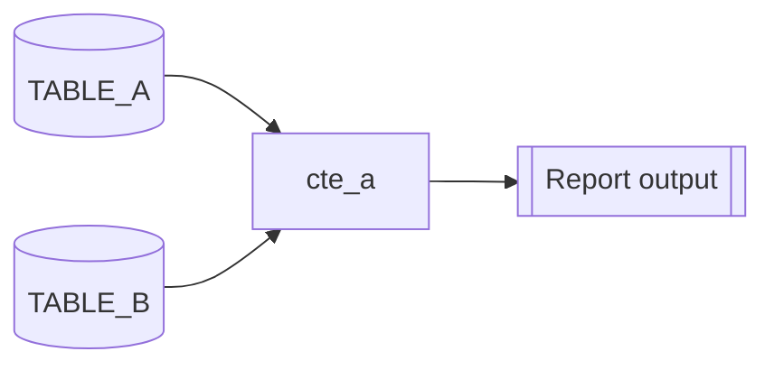

# SQL Explained: {{REPORT_ID}} {{TITLE}}

> A plain-English walkthrough of `04-data-model.sql`: what each part does, which Fusion tables it reads, how they join, and **where each fact came from**.
> Source tags: **[ORACLE_DOCS]** docs.oracle.com · **[CONFIG_DOC]** your configuration docs · **[KB]** knowledge base · **[USER]** confirmed by you in DEV · **[VERIFY]** not yet confirmed

## 1. In one paragraph
What the query returns, at what grain (one row per …), which parameters drive it, and the one or two business rules that most shape the result.

## 2. Data lineage

## 3. Step by step (one section per CTE, in SQL order)

### 3.n `<cte_name>`: <business concept>
- **Returns:** one row per …
- **Reads:** `TABLE_X` ([ORACLE_DOCS](url), release) · `TABLE_Y` ([ORACLE_DOCS](url))
- **Joins:** `x.col = y.col`, why this key, and whether it is 1:1 or 1:many
- **Filters:** each predicate → the parameter (`:p_…`), business rule (`BR-n`) or convention (`C-xx`) that requires it
- **De-duplication:** key + tie-break and why (if any)
- **Environment-specific values:** `ATTRIBUTEn` / role ID / lookup code → meaning [CONFIG_DOC: file > section]

## 4. Column lineage
| # | Output column | From CTE | Source table.column | Transformation | Source |
|---|---|---|---|---|---|

## 5. Parameters → where they act
| Parameter | Bind | Applied in | Predicate | Convention |
|---|---|---|---|---|

## 6. What can make a value blank or a row disappear
| Symptom | Cause in the SQL | Expected? |
|---|---|---|

## 7. Sources
- Oracle Docs pages used (object → URL, release)
- Configuration documents used (file > section)
- Knowledge base / lessons applied (L-xxx)
- Still to verify (discovery query IDs)
